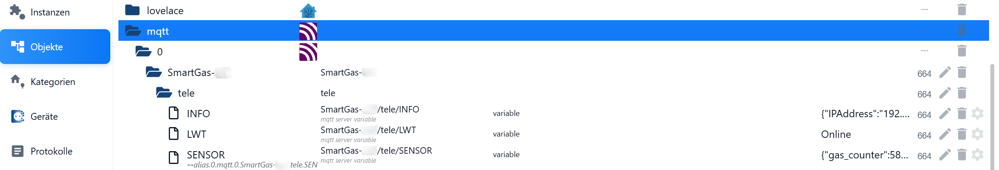
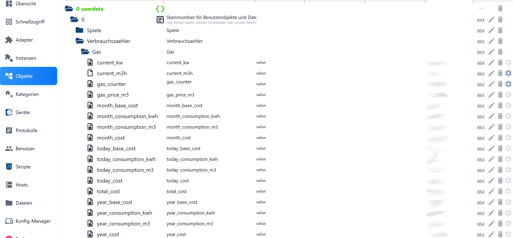
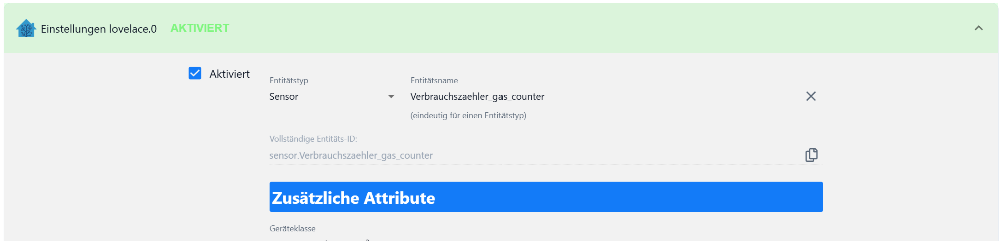

# iob.sg.iz.plus.sensor.reader

ioBroker-JavaScript-Skript, das die MQTT-JSON-Daten eines **SmartGas Impulszählers (SG-IZ-Plus-BK)** einliest und in einzelne Datenpunkte im Aliasbereich schreibt. Fehlende Datenpunkte werden automatisch angelegt.

## Funktionsweise

1. Der Zähler publiziert per MQTT ein JSON-Objekt auf `mqtt.0.SmartGas-XXX.tele.SENSOR`.
2. Das Skript lauscht per `on({ change: 'ne' })` auf Änderungen, parst das JSON und schreibt jeden bekannten Wert nach `0_userdata.0.Verbrauchszaehler.Gas.<id>`.
3. `setStateSafe()` legt nicht vorhandene Datenpunkte bei Bedarf an (`type: number`, `role: value`, `read: true`, `write: false`).
4. Fehlende Werte werden auf `0` gesetzt; Parse-Fehler erzeugen eine Warnung im Log.

## Konfiguration

Im Skript ([iob-sg-iz-plus-sensor-reader.js](iob-sg-iz-plus-sensor-reader.js)) anzupassen:

| Konstante | Bedeutung | Standard |
|-----------|-----------|----------|
| `jsonObjId` | MQTT-Datenpunkt mit dem SENSOR-JSON (Geräte-ID anpassen) | `mqtt.0.SmartGas-XXX.tele.SENSOR` |
| `rootId` | Zielordner für die erzeugten Datenpunkte | `0_userdata.0.Verbrauchszaehler.Gas` |
| `datapointIds` | Liste der aus dem JSON übernommenen Schlüssel | 17 Keys (s. u.) |

## Datenpunkte

`gas_counter`, `current_kw`, `current_m3h`, `total_cost`,
`today_consumption_m3`, `today_cost`, `today_base_cost`,
`month_consumption_m3`, `month_cost`, `month_base_cost`,
`year_consumption_m3`, `year_cost`, `year_base_cost`,
`today_consumption_kwh`, `month_consumption_kwh`, `year_consumption_kwh`,
`gas_price_m3`

## Datenfluss

### 1. MQTT-Quelle (`mqtt.0.SmartGas-XXX`)
Der Zähler legt unter `tele/SENSOR` das JSON ab, das als Eingang dient.

### 2. Erzeugte Datenpunkte (`0_userdata.0.Verbrauchszaehler.Gas`)
Pro JSON-Schlüssel ein Datenpunkt, vom Skript automatisch angelegt.

### 3. Lovelace-/Home-Assistant-Anbindung
Der Datenpunkt `gas_counter` wird als Entität `sensor.Verbrauchszaehler_gas_counter` eingebunden.

## Installation

1. Skriptinhalt in ioBroker (Adapter **javascript**) als neues Skript einfügen.
2. `jsonObjId` auf die reale MQTT-Geräte-ID anpassen.
3. Skript starten – die Datenpunkte unter `rootId` werden beim ersten Empfang erzeugt.

## Lizenz

[Apache License 2.0](LICENSE)
